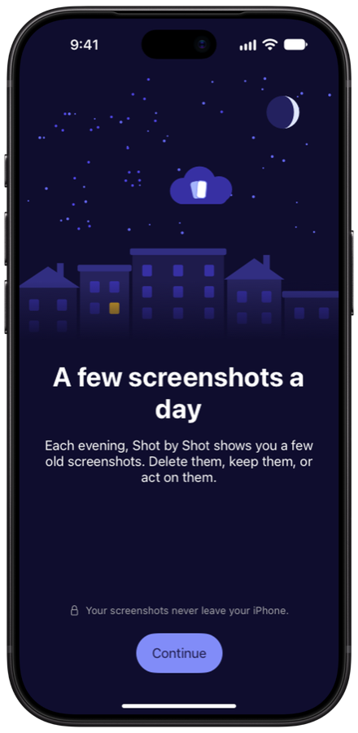
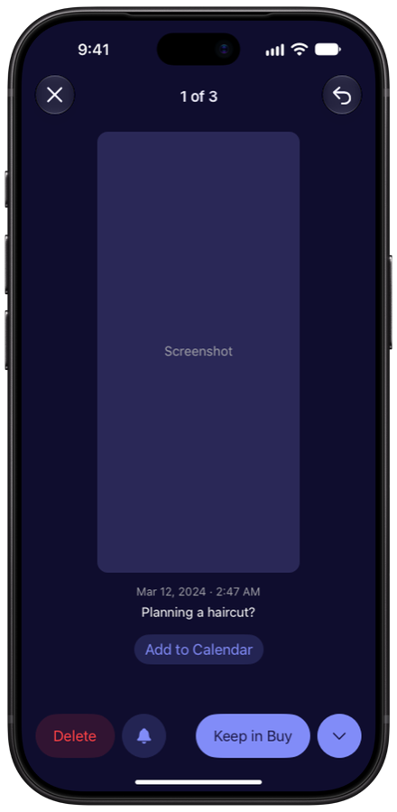
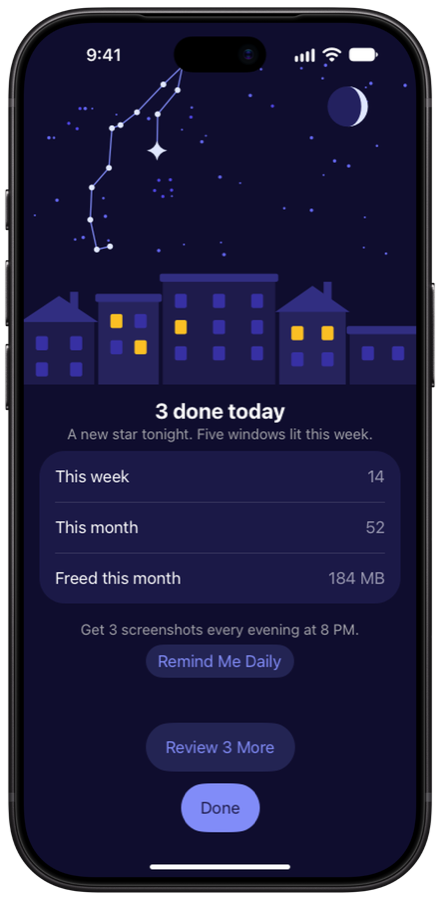
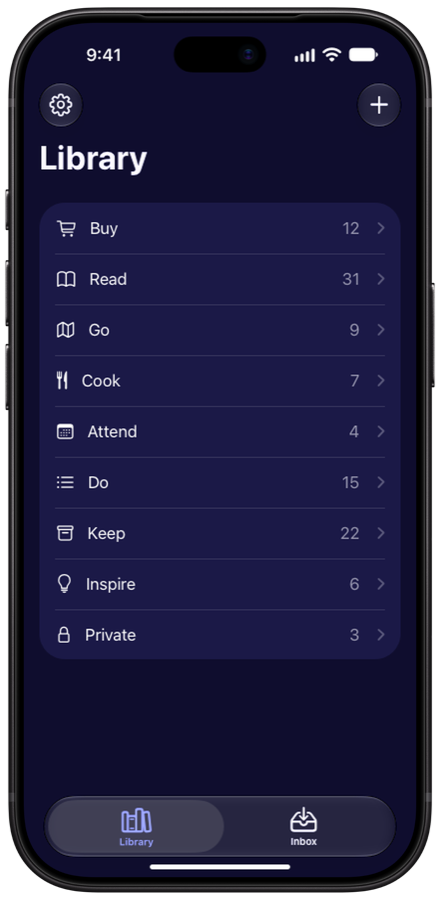

# Shot by Shot

An iOS app that helps you clear out old screenshots a few at a time. Each evening it shows you three old screenshots, and for each one you decide: delete it, keep it in a category, or set a reminder.

Built at the Apple Developer Academy.

<p align="center">
  
  
  
  
</p>

## Features

- **Daily session.** A short batch of old screenshots, one at a time, with Delete, Keep in a category and Remind. Decisions can be undone during the session.
- **On-device suggestions.** Apple Intelligence (Foundation Models) suggests a category and a short guess about why you took the screenshot, plus a context action such as Add to Calendar, Open in Maps or Call. Without Apple Intelligence the app works the same, minus suggestions.
- **Privacy first.** Screenshots that look like passwords, card numbers or documents are detected with on-device text recognition and stay blurred until you tap Show. The Private category is locked with Face ID. Images never leave the phone, and the app has no network code at all.
- **Library.** Saved screenshots are grouped into categories: Buy, Read, Go, Cook, Attend, Do, Keep, Inspire and more.
- **Progress.** Each finished session lights a window in a small city illustration and adds a star to the month's constellation.
- **Widget and Share extension.** A home screen widget shows how many screenshots are waiting and how many nights you've kept the habit this month; screenshots can be sent to the app from the share sheet.
- **Reminders.** A daily evening notification and per-screenshot reminders.

## Tech

- Swift 6 with strict concurrency, SwiftUI, `@Observable`, SwiftData
- PhotoKit: the app stores references to Photos assets, not copies of images
- Foundation Models, Vision, SensitiveContentAnalysis
- LocalAuthentication, UserNotifications, EventKitUI, WidgetKit
- Native system components only, semantic colors, Dynamic Type up to AX5, VoiceOver labels, Reduce Motion support
- No third-party dependencies

## Project structure

```
ShotByShot/
  App/            app entry point, root view, share import
  Core/           models, Photos, on-device intelligence, sensitivity rules,
                  reminders, Face ID lock, progress rules
  DesignSystem/   shared views and the city illustration
  Features/       Onboarding, Inbox, Session, Library, Settings, Add Screenshot
  Resources/      asset catalog, String Catalog, app icon, constellations
ShotByShotShare/      share extension
ShotByShotWidget/     home screen widget
ShotByShotTests/      unit tests (Swift Testing)
ShotByShotUITests/    UI tests and accessibility audits
```

## Requirements

- Xcode 27
- iOS 26 or later
- Apple Intelligence on a supported iPhone for suggestions (optional)

## Running

1. Open `ShotByShot.xcodeproj`.
2. Pick your own development team under Signing & Capabilities for each target.
3. Run the `ShotByShot` scheme on a device or simulator.

To try the app without a real photo library, add the `-sampleLibrary` launch argument to the scheme.

Run the tests with `⌘U`.
